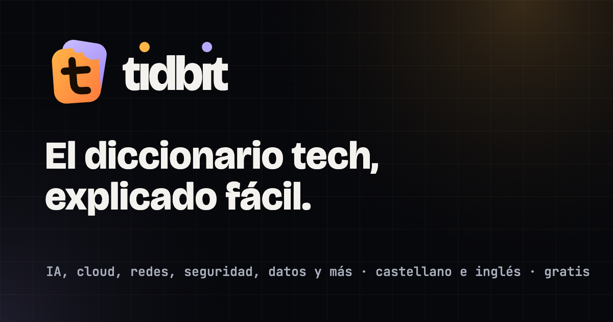
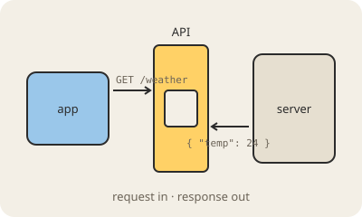
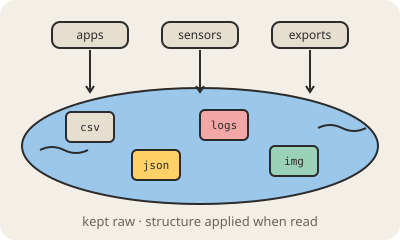
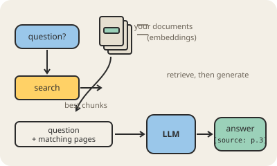
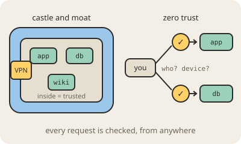

<div align="center">


# tidbit

**El diccionario tech, explicado fácil, en castellano y en inglés.**
¿Qué es una API, un token, un data lake o una VPN? Cada término en palabras simples, para gente curiosa que no es ingeniera.

[**tidbit.legios.com.ar/es**](https://tidbit.legios.com.ar/es/) ·
[In English](README.md) ·
[Desarrolladores](https://tidbit.legios.com.ar/es/developers/) ·
MIT

<sub>Un instrumento de</sub><br>
<a href="https://github.com/legiosai"><picture>
  <source media="(prefers-color-scheme: dark)" srcset="docs/legios.svg">
  <source media="(prefers-color-scheme: light)" srcset="docs/legios-claro.svg">
  
</picture></a>

<a href="https://tidbit.legios.com.ar/es/"></a>

</div>

> **Estado: 102 términos en 9 temas**, cada uno en castellano y en inglés: IA, AWS, cloud, redes, seguridad, datos, hardware, software y empresas tech. Sin cuenta y sin rastreo: los términos que aprendiste y el término del día viven en tu navegador.

## Cómo es una entrada

Cada término tiene una definición de una línea, de dos a cuatro párrafos cortos, una analogía de todos los días, tres o cuatro puntos para recordar, un diagrama y links a la documentación oficial. Tiene un nivel (básico, intermedio, avanzado), y cada palabra técnica que tiene su propia entrada la enlaza, así podés seguir el hilo desde lo básico hasta lo avanzado.

<table>
<tr>
<td width="50%"><a href="https://tidbit.legios.com.ar/es/api/"></a><br><b><a href="https://tidbit.legios.com.ar/es/api/">API</a></b> · básico<br>El menú de cosas que un programa le deja pedir a otro programa.</td>
<td width="50%"><a href="https://tidbit.legios.com.ar/es/data-lake/"></a><br><b><a href="https://tidbit.legios.com.ar/es/data-lake/">Data lake</a></b> · intermedio<br>Almacenamiento barato donde todos los datos se guardan como archivos crudos.</td>
</tr>
<tr>
<td width="50%"><a href="https://tidbit.legios.com.ar/es/rag/"></a><br><b><a href="https://tidbit.legios.com.ar/es/rag/">RAG</a></b> · intermedio<br>Dejar que el modelo busque en tus documentos antes de responder.</td>
<td width="50%"><a href="https://tidbit.legios.com.ar/es/zero-trust/"></a><br><b><a href="https://tidbit.legios.com.ar/es/zero-trust/">Zero trust</a></b> · avanzado<br>Seguridad que revisa cada pedido, en vez de confiar en lo que está adentro de la red.</td>
</tr>
</table>

El inicio muestra un término distinto cada día que entrás: uno que tu navegador nunca te mostró, lo básico primero. Cuando ya viste todos, vuelve el que viste hace más tiempo.

## Para desarrolladores y agentes de IA

Todo se puede leer con código, gratis, de solo lectura y sin cuenta. [Is Agentic](https://is-agentic.com/scan/tidbit.legios.com.ar) le pone 100/100.

- **Markdown**: mandá `Accept: text/markdown` a cualquier página, o agregá `index.md` a su URL. Los 404 también responden en Markdown.
- **API JSON**: [`/v1/terms.json`](https://tidbit.legios.com.ar/v1/terms.json) lista todos los términos; `/v1/terms/<slug>.json` trae la entrada completa. [OpenAPI](https://tidbit.legios.com.ar/openapi.json), errores RFC 9457, headers `RateLimit` de uso justo.
- **Servidor MCP**: [`/mcp`](https://tidbit.legios.com.ar/.well-known/mcp/server-card.json), Streamable HTTP sin autenticación, con `search_terms`, `get_term`, `list_topic` y `term_of_the_day`.

```json
{ "mcpServers": { "tidbit": { "type": "http", "url": "https://tidbit.legios.com.ar/mcp" } } }
```

- **Para agentes**: [`llms.txt`](https://tidbit.legios.com.ar/llms.txt) dice cuándo usar Tidbit y cuándo no; [`es/llms-full.txt`](https://tidbit.legios.com.ar/es/llms-full.txt) tiene todas las entradas en castellano.

## Cómo funciona

- `content/entries/*.json`: un archivo por término, con los dos idiomas adentro. `content/img/*.svg`: su diagrama. `content/subjects.json`: los temas.
- `scripts/build-index.mjs` (`npm run index`): valida cada entrada y regenera `content/index.json`.
- `scripts/build-site.mjs` (`npm run build`): arma `dist/` con una página HTML real por URL (se lee sin JavaScript) y su gemela en Markdown, en inglés en `/` y en castellano en `/es/`: inicio, A–Z, temas, cada término, Acerca de, Contacto, Privacidad y Desarrolladores. También el sitemap, `robots.txt`, `llms.txt`, la API JSON, OpenAPI, el server card de MCP y una skill para agentes.
- `app.js`, `style.css`: lo que depende de quien visita (el término del día, las aprendidas, los filtros del A–Z) sobre las páginas ya armadas.
- `site/_worker.js`: el worker de Cloudflare Pages. Markdown con `Accept: text/markdown` y `Vary: Accept`, headers `Link`, errores en JSON y límites de uso en la API, y el servidor MCP.
- `.github/workflows/site.yml`: valida y arma el sitio en cada push y pull request, y una vez por día para publicar las entradas con fecha futura.

## Correr local

```bash
npm ci
npm run dev        # http://localhost:8788, con el worker andando (wrangler pages dev)
```

## Agregar una entrada

Leé [CONTRIBUTING.md](CONTRIBUTING.md): tiene el formato, la voz y las reglas de los diagramas. En corto: copiá una entrada existente, escribí los dos idiomas, dibujá el SVG, corré `npm run index`, abrí un pull request.

`scripts/generate.mjs` puede redactar un borrador con Claude (necesita credenciales de Anthropic: `ANTHROPIC_API_KEY` o un perfil de `ant auth login`; un endpoint compatible con Anthropic funciona vía `ANTHROPIC_BASE_URL`). Revisá lo que escribe antes de commitearlo.

```bash
npm run generate -- --subject networks --topic "DNS"
```

## Publicar

`npm run deploy` (`scripts/deploy.sh`) arma el sitio y lo sube al proyecto `tidbit-legios` de Cloudflare Pages, que sirve `tidbit.legios.com.ar`. Si el repo tiene el secreto `CLOUDFLARE_API_TOKEN`, el workflow lo hace solo en cada push a `main`. GitHub Pages queda como redirección: los links viejos (`legiosai.github.io/tidbit/#/e/...`) llevan al dominio nuevo.

Las imágenes para compartir (`assets/og-*.png`) se dibujan con `scripts/og.html`.

## Licencia

[MIT](LICENSE). Hecho por [Legios](https://github.com/legiosai).
